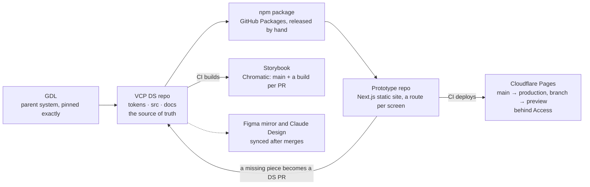

# VCP Design System — Build & Maintain Playbook

Last updated 6 November 2026. This file is the canonical copy; a shareable Claude Doc mirrors it, and if the two differ, this file wins.

## How to use this playbook

This playbook tells an AI agent how the VCP Design System is built and run, so it can maintain VCP or build another system the same way. It is drawn from the live repos as of 4 Nov 2026: `VDM-Design-Team/VCP-design-system` (the system, 920 commits since 18 Aug 2026) and `VDM-Design-Team/VCP-prototype` (the screens).

**Read order for an agent starting cold**

1. This playbook, once, end to end.
2. The repo's `CLAUDE.md`: the binding rules. Where this playbook and `CLAUDE.md` disagree, `CLAUDE.md` wins, because it is versioned with the code.
3. `docs/workflow.md`: roles, reviews, checks, branch rules.
4. Before touching a piece: its `docs/<name>.md` and its `.stories.tsx`.

**Non-negotiables.** Each one is enforced by a check (see Quality gates).

- The repo is the source of truth. Figma and Claude Design mirror it, never the other way round.
- Tokens before components. No hex, no raw `px`, no arbitrary Tailwind class such as `bg-[#336afa]`.
- Components use semantic tokens only, so the dark theme works for free.
- Every piece ships three files: `.tsx`, `.stories.tsx`, `docs/<name>.md`.
- Imports flow down the tiers only: atoms ← components ← patterns ← templates.
- Every PR that touches `src/` or `tokens/` adds its own `changes/<branch>.md` entry.
- Nothing reaches `main` except through a PR with green checks.
- Screens are built only from the published package. A missing piece is a design-system PR, not a local component.

## The system at a glance

One repo owns everything; every other surface is generated from it or consumes it. Design and engineering both change the repo, by PR, usually through Claude.



Solid arrows are what CI or a release does; the dashed line is a manual mirror. The loop is the rule that keeps screens honest: a piece the prototype lacks goes back to the DS repo as a PR.

| Piece | Where it lives | What it is | How it changes |
| --- | --- | --- | --- |
| GDL | `@vdm-design-team/gdl` on GitHub Packages | The parent design system: shared colour families, spacing, fonts, elevation, the type ramp, the Style Dictionary formats and the semantic-name contract | A GDL PR, then an exact-pinned bump in VCP (`"1.0.0"`, no `^`) |
| VCP DS repo | [VDM-Design-Team/VCP-design-system](https://github.com/VDM-Design-Team/VCP-design-system) | Tokens, React components, usage docs, Storybook, the rules for AI (`CLAUDE.md`) | Branch → PR → checks → review → merge |
| npm package | `@vdm-design-team/vcp-design-system` on GitHub Packages (private) | What apps install: components, types, `theme.css`, token values, docs | Released from `main` (0.1.0 on 3 Nov 2026) |
| Storybook | [main--6aba746352fe3d50eea0cdab.chromatic.com](https://main--6aba746352fe3d50eea0cdab.chromatic.com) plus one build per PR | The visual library and the review surface | Built by CI on every push |
| Prototype repo | [VDM-Design-Team/VCP-prototype](https://github.com/VDM-Design-Team/VCP-prototype) | Next.js static app: one screen per route, built only from the package | Branch → PR → preview link → merge |
| Cloudflare Pages | Project `vcp-prototype` (`*.vcp-prototype.pages.dev`), behind Cloudflare Access | Hosts the prototype: `main` is production, every branch gets a preview URL | Deployed by the prototype's CI |
| Figma, Claude Design | Figma files; a Claude Design project | Mirrors for exploration. Never authoritative | Updated after token PRs merge (same week) |
| Claude plugin | `plugin/` in the DS repo | `/vcp-morning`: a read-only morning brief for designers | A DS repo PR with a version bump |

**Stack.** React 19 · TypeScript · Tailwind CSS v4 (CSS-first theme) · class-variance-authority + clsx + tailwind-merge · Style Dictionary 5 with DTCG JSON · Storybook 10 (`react-vite`) with the docs, a11y, vitest and MCP addons · Vitest browser mode on Playwright Chromium · Chromatic · tsup · Next.js 16 static export · Cloudflare Pages via `wrangler-action` · Node 22 (DS CI) and 24 (prototype CI).

## Repository structure

Every piece lives in a kebab-case folder under its tier, with a PascalCase component file, its stories and an `index.ts`; its usage page sits in `docs/` under the same kebab name.

```
VCP-design-system/
├─ CLAUDE.md                  binding rules for every AI session
├─ AGENTS.md                  older copy of the rules (stale: trust CLAUDE.md)
├─ README.md                  for engineering, for design, governance
├─ tokens/
│  ├─ core/                   VCP-only raw values: color.vcp-blue.*, color.brand.navy, UI font
│  └─ semantic/               intent: color.json, color.dark.json, shape.json, border.json
├─ style-dictionary.config.mjs   token build, on GDL's formats
├─ dist/                      GENERATED and gitignored: theme.css, tokens*.css/json/ts, index.js, types/
├─ src/
│  ├─ atoms/button/           Button.tsx · Button.stories.tsx · index.ts
│  ├─ components/field/       same three files
│  ├─ patterns/top-bar/       same three files
│  ├─ templates/app-shell/    same three files
│  ├─ foundations/            Foundations.stories.tsx: the token gallery in Storybook
│  ├─ lib/                    cn.ts, shared logic, story-* helpers (helpers not shipped)
│  └─ index.ts                the package's single export barrel
├─ docs/
│  ├─ <name>.md               one usage page per piece (109 today: every piece has one)
│  └─ color-tokens.md, type-tokens.md, workflow.md, handoff.md, inventory.md, playbook.md
├─ changes/<branch>.md        one changelog fragment per PR
├─ CHANGELOG.md               written only by `npm run changelog`
├─ scripts/                   custom lints and release tools (.mjs)
├─ .storybook/                main.ts, preview.ts, storybook.css
├─ .github/                   workflows/ci.yml, workflows/chromatic.yml, pull_request_template.md
├─ .claude/commands/          /latest and /morning for local Claude sessions
├─ plugin/, .claude-plugin/   the /vcp-morning plugin for designers
├─ Onboarding/README.md       a 15-minute setup for a new teammate
├─ preview/, gallery/         token-pipeline smoke test; static token gallery
└─ tsup.config.ts, tsconfig.build.json, vitest.config.ts
```

Three files carry project memory for the next agent: `docs/handoff.md` (state, what waits on whom, written in roles), `docs/inventory.md` (every piece, its tier, what is blocked) and `CHANGELOG.md`. Keep them current; an agent reads them before it acts.

## Design tokens

Tokens are DTCG JSON in two layers, built by Style Dictionary into a Tailwind v4 theme, so every token becomes a utility class and nothing else is allowed in a component.

### The layers

| Layer | File | Holds | Example | Rule |
| --- | --- | --- | --- | --- |
| Core, shared | GDL package | Colour families (`slate`, `blue`, `red`…), spacing, fonts, elevation, the type ramp `type.*` | `color.red.600` | Change it in GDL, then bump the exact pin |
| Core, VCP's own | `tokens/core/*.json` | Only what is VCP's: the `vcp-blue` ramp, the navy logo mark, the UI face | `color.vcp-blue.500` = `#1a56db` | The only place a colour hex may appear |
| Semantic | `tokens/semantic/color.json`, `shape.json`, `border.json` | Intent | `action.primary.surface.hover` → `{color.vcp-blue.600}` | Colours reference core tokens only. `shape.json` and `border.json` still hold their raw radii, widths and shadow values, a known gap with `CLAUDE.md` rule 2 |
| Dark | `tokens/semantic/color.dark.json` | The same names, pointing at other core values | built to `dist/tokens.dark.css` as `.dark` overrides | Components never branch on theme |

### Naming

Semantic colour names copy the Figma variables exactly, so design and code say the same word:

- `surface.*`: backgrounds (`canvas`, `base`, `elevated`, `overlay`, `brand`, `track`).
- `text.*`: text and icons (`primary`, `secondary`, `tertiary`, `subtle`, `disabled`, `link`, `inverted`).
- `stroke.*`: borders (`default`, `subtle`, `strong`, `stronger`, `focused`, `brand`, `inverse`).
- `action.{primary|secondary|tertiary}.{surface|content|border}.{default|hover|pressed|disabled}`: controls.
- `accent.{critical|success|warning|info|pending|…}.{filled|outline|tonal}.{surface|content|border}.{state}`: status.
- `neutral.{outline|tonal|textual}.…`: controls that are deliberately not an action (the grey Cancel).
- Shape: `radius.xs|sm|md|pill` (4, 6, 8, 999 px), `shadow.card|raised|menu|modal`, `borderWidth.default|focused` (1, 2 px).

Which token to reach for is a separate question, answered in `docs/color-tokens.md`: pick by the role the element plays, prefer the most specific family (a button label is `action.*.content.*`, not `text.primary`), and use the state token rather than opacity.

### The build

`npm run tokens` runs `style-dictionary build --config style-dictionary.config.mjs`. The config:

- `include: gdlIncludes()` pulls GDL's tokens in; VCP's win on a name collision.
- `source: ['tokens/**/*.json']` adds VCP's.
- `platforms: gdlPlatforms()` reuses GDL's outputs, with one custom format, `vcp/tailwind-theme`. It swaps GDL's `@import "tailwindcss"` for `@source "./index.js"`, so an app's own Tailwind generates the component classes and Tailwind is never loaded twice. The format throws if GDL's output changes shape.

| Output in `dist/` | Used by |
| --- | --- |
| `theme.css` | Apps and Storybook: the `@theme` block that turns tokens into utilities |
| `tokens.css`, `tokens.dark.css` | Plain CSS variables, light and `.dark` |
| `tokens.ts` → `tokens.js` | Token values for server code (`/tokens` export, not a client module) |
| `tokens.json`, `tokens.flat.json` | The Storybook token gallery, the static gallery, other tools |

### Using tokens in code

- Colour: `bg-surface-canvas`, `text-text-primary`, `border-stroke-default`, `bg-action-primary-surface-default`, `bg-accent-critical-tonal-surface-default`.
- Type: `text-{tier}-{size}-{weight}`, such as `text-body-md-regular`. Size, line height, weight and tracking come as one unit. Poppins is `font-sans`; Inter is `font-numeric` for dense numbers.
- Spacing: Tailwind's numeric scale is **not** overridden, because VCP's px scale equals it (`p-1` = 4px, `p-4` = 16px, `p-16` = 64px).
- Radius and shadow: `rounded-sm`, `rounded-md`, `shadow-card`, `shadow-menu`.
- `src/lib/cn.ts` declares the type ramp to tailwind-merge. Without it, tailwind-merge files `text-label-sm-medium` as a colour and silently drops it next to `text-text-primary`. `lint:tokens` fails if that list drifts from GDL's ramp.

The first token set was seeded from Figma's variables export by `scripts/import-figma-tokens.mjs` (it overwrites `tokens/core` and `tokens/semantic`, so re-running it now would undo the move of the shared scales to GDL: don't). After that, the repo leads and Figma variables are updated to match within the same week.

## The four tiers

The system is atomic-design shaped, and a piece's tier is decided by **what it composes, not by its vocabulary**: domain words such as statuses or roles may appear at any tier. Today: 30 atoms, 57 components, 21 patterns, 1 template.

| Tier | Folder | Test | VCP examples | May import |
| --- | --- | --- | --- | --- |
| Atom | `src/atoms/` | One self-contained element a designer names as one thing. May use `Icon` as decoration, nothing else from the system | `Button`, `Input`, `Badge`, `Avatar`, `Toggle`, `Tooltip`, `Logo` | `lib/` and `Icon` |
| Component | `src/components/` | One control or display unit assembled from atoms (and other components), however rich inside | `Field`, `SearchSelect`, `Menu`, `Modal`, `DataTable`, `DatePicker`, `StatusTag` | Atoms, components |
| Pattern | `src/patterns/` | Two or more pieces composed into a distinct page section (an organism) | `TopBar`, `Sidebar`, `PlanningTable`, `CommentSection`, `ChangePasswordForm`, the AV modals | Atoms, components, patterns |
| Template | `src/templates/` | A page-level layout that arranges patterns into a whole screen | `AppShell` | Everything below |

**How to pick a tier before writing**

1. Does it compose any other piece of the system? No → atom.
2. Does it present as one control or one display unit? Yes → component, even if it is big (`DataTable` is a component).
3. Is it a distinct section of a page built from two or more pieces? Yes → pattern. `lint:composition` fails a pattern built from fewer than two.
4. Does it lay out a whole screen? Yes → template.

**Rules that follow**

- Imports flow downward only. If a lower tier needs something from a higher one, the dependency points the wrong way: lift that knowledge into a prop. Stories are exempt, so an atom's story may demo it inside a component.
- Each domain mapping has exactly one owner. `StatusTag` owns status → tone; call sites never re-derive it.
- Storybook titles mirror the tiers: `Atoms/Button`, `Components/Forms/Field`, `Components/Overlays/Menu`, `Patterns/TopBar`, `Templates/AppShell`. Components keep a function group one level down.
- A piece that outgrows its tier **moves**; it is never copied. Moving changes the import path, so it is a major bump.
- Choose the tier before writing. Once other pieces import it, a wrong tier is expensive to undo.

## Anatomy of a piece

Every piece, at every tier, is three files that ship together: the component, its stories, and its usage page. A PR that adds one without the others is incomplete.

### 1. The component (`src/<tier>/<name>/<Name>.tsx`)

- Variants come from `cva` (class-variance-authority); classes merge through `cn()` (clsx + the extended tailwind-merge in `src/lib/cn.ts`), with the caller's `className` last.
- `React.forwardRef`, a `displayName`, props that extend the native element's attributes, and `...props` spread onto the root.
- Every class is a token utility. A comment over each variant names its token family (`/* action.secondary — outlined */`).
- Prop names are the same everywhere so developers can guess them: `variant`, `size` (`sm|md|lg`), `fullWidth`, `loading`. A prop never reuses an HTML attribute's name for something else (`UserLabel`'s `role` became `description`).
- A prop exists only when a real call site needs it. Storybook-only switches live in the story's args, not the component.
- Behaviour contracts are explicit. For example, an editable control times nothing and reverts nothing: the parent owns saving (`src/lib/saving.ts`).
- Motion that starts by itself stops within 5 s and respects `motion-reduce`.
- Export it from the folder's `index.ts`. An atom or component then gets `export * from './<tier>/<name>'` in `src/index.ts`; a pattern or template goes in `src/patterns/index.ts` or `src/templates/index.ts`, which `src/index.ts` already re-exports.

```tsx
const button = cva(
  ['inline-flex items-center justify-center gap-1.5 font-sans text-label-sm-medium rounded-sm',
   'focus-visible:outline-2 focus-visible:outline-offset-2 focus-visible:outline-stroke-focused'],
  {
    variants: {
      variant: {
        /* action.primary — filled */
        primary: 'bg-action-primary-surface-default text-action-primary-content-default hover:bg-action-primary-surface-hover',
        /* action.secondary — outlined */
        secondary: 'bg-action-secondary-surface-default border border-action-secondary-border-default',
      },
      size: { sm: 'h-9 px-3', md: 'h-10 px-4', lg: 'h-12 px-5' },
      fullWidth: { true: 'w-full', false: '' },
    },
    defaultVariants: { variant: 'primary', size: 'md', fullWidth: false },
  },
);

export interface ButtonProps
  extends React.ButtonHTMLAttributes<HTMLButtonElement>, VariantProps<typeof button> {
  loading?: boolean;
}

export const Button = React.forwardRef<HTMLButtonElement, ButtonProps>(
  ({ className, variant, size, fullWidth, loading, disabled, ...props }, ref) => (
    <button ref={ref} className={cn(button({ variant, size, fullWidth }), className)}
      disabled={disabled || loading} aria-busy={loading || undefined} {...props} />
  ),
);
Button.displayName = 'Button';
```

### 2. The stories (`<Name>.stories.tsx`): controls and tests in one file

- The meta sets `title` (by tier), `component`, `parameters.docs.description.component` (one paragraph on when to use each variant), default `args`, and `argTypes` controls: `select` for `variant`, `radio` for `size`; booleans get a toggle automatically. Write it as `const meta = {…} satisfies Meta<typeof Button>`.
- One story per variant, then `Sizes` and `States` (default, hover where testable, focus, disabled, loading, error, empty).
- Behaviour stories are named as claims and carry a `play` function that asserts with `expect` from `storybook/test`: `FilledTextContrast`, `EmptyPartsRenderNothing`. A fix lands with a story that fails without it.
- A JSDoc comment above a story becomes its description on the Docs page.
- **Playground pattern** for story-only switches: a `PlaygroundArgs` type adds booleans such as `withAction`, hidden from the props table with `table: { disable: true }` and translated into real props inside `render`.
- Stateful demos write back with `useArgs` from `storybook/preview-api`; save flows use `useFakeSave` from `src/lib/story-saving.ts`.
- Full-screen overlays spread `OVERLAY_DOCS_STORY` (`src/lib/story-docs.ts`) into `parameters.docs.story`, so each dialog gets its own iframe on the Docs page.
- A light-and-dark side-by-side story wraps one half in a `.dark` div and spreads `SIDE_BY_SIDE` (`src/lib/story-a11y.ts`), the only accepted exemption for two landmarks.
- To let one story lay itself out, the meta's decorator steps aside on `parameters.layout === 'fullscreen'` or a custom parameter. Never `decorators: []`: it removes nothing.

### 3. The usage page (`docs/<name>.md`)

The page ships inside the npm package, so an AI building a screen reads it from `node_modules`. Shape:

```markdown
# ChangePasswordForm *(pattern)*
One line: what it is, and the Figma frame it was built to.

## Composed of            <- components, patterns, templates only
| Piece | Tier |
| `Button` | atom |
| `PasswordField` | component |

## When to use            <- or, for an atom: | Variant | Use for | Max per screen |
| Use | For |

## Props
| Prop | Type | Default | Notes |

## Tokens                 <- any tokens of its own, and why
## Accessibility          <- targets, roles, focus, contrast, documented exceptions
## Don't                  <- the misuses review keeps finding
```

`lint:composition` checks “Composed of” against the real imports, so it cannot drift. When a rule is consciously broken (the `neutral` Button's border is 2.56:1 on white), the page says so and gives the reasoning.

## Storybook

Storybook is the shared visual library, the review surface and the test runner at once: every story renders in a real browser, runs its `play` function and passes axe, or `npm test` fails.

### Configuration

| File | What it sets |
| --- | --- |
| `.storybook/main.ts` | Framework `@storybook/react-vite`; stories `src/**/*.stories.@(ts\|tsx)`; addons `addon-docs`, `addon-a11y`, `addon-mcp`, `addon-vitest`; Tailwind added in `viteFinal` through `@tailwindcss/vite` |
| `.storybook/storybook.css` | The same imports an app makes: Google Fonts (Poppins, Inter), `@import 'tailwindcss'`, `@import '../dist/theme.css'`, plus `@source '../src'`. The body background is `--color-surface-canvas`, so dark stories don't float on white |
| `.storybook/preview.ts` | `tags: ['autodocs']` (a Docs page for every piece); a **Theme** toolbar (light/dark); a decorator that toggles `.dark` on `<html>`, so portalled overlays are themed too; `a11y: { test: 'error', config: A11Y_CONFIG }`; sidebar order `Foundations`, `Actions`, then the rest |
| `vitest.config.ts` | The `storybookTest` plugin in browser mode, Playwright Chromium, headless. `npm run test:flows` runs it |

### What a reader finds

- `Foundations/Tokens`: every colour, type size, space, radius and shadow, rendered from `dist/tokens.json` with its utility class.
- One entry per piece, titled by tier. Its Docs page shows the description, the primary story with live **Controls**, the props table, then every other story.
- The Theme toolbar flips every story into dark.

### Published Storybook and visual review (Chromatic)

- `.github/workflows/chromatic.yml` builds Storybook (`npm run storybook:build`) on every push to `main` and every PR. `main` publishes to a fixed URL; each PR gets its own.
- **TurboSnap** (`onlyChanged: true`) snapshots only affected stories. Tokens are invisible to its module trace (stories import the built `dist/`), so `externals: '{tokens/**,style-dictionary.config.mjs}'` forces a full snapshot whenever tokens change. PR #66 deleted a colour ramp and was not snapshotted before this was added.
- `autoAcceptChanges: main`: every `main` build becomes the new baseline automatically, so PRs always diff against the current `main`.
- A sticky **🔍 Visual review** comment on each PR, updated on every push, links the before/after diffs and the branch's Storybook, deep-linked to the Docs page of each piece the PR touched.
- Diffs are approved by the PR's reviewer, never its author. Chromatic's free plan allows 5,000 snapshots a month. When it runs out, “UI Tests: pending” means no tests ran, not that diffs await approval.

### Storybook for agents

`@storybook/addon-mcp` serves `localhost:6006/mcp`, so an agent can ask “what variants does Button have?”. It needs Storybook running (`npm run dev`); if Storybook is down, the MCP server fails to connect.

## Accessibility

Accessibility is a merge condition, and most of it is machine-checked: axe runs on every story as a failing test, and custom checks cover what axe cannot see.

| Rule | Threshold | Enforced by |
| --- | --- | --- |
| Text contrast | 4.5:1, both themes, at rest, hovered and pressed | axe on every story; `play` stories such as `FilledTextContrast` that compute the ratio |
| UI boundaries | 3:1 | Review; for form fields, `check:field-contrast` (rest, error, warning, focused, both themes) |
| Focus ring | Always visible: `focus-visible:outline-2 outline-offset-2 outline-stroke-focused` | Review; never removed |
| Touch target | 40 × 40 px minimum | Review. Smaller (`sm` = 36 px) only where a pointer is guaranteed, and the doc says so |
| Icon-only controls | `aria-label` (or a `title` that is the name) | axe |
| Say it once | A description must add something its element's name lacks | The house axe rule `vcp-description-repeats-name` in `src/lib/story-a11y.ts`. A tooltip that repeats its trigger takes `describe={false}` |
| Never drop focus | When the focused element goes away (a box closes, a row is deleted), focus moves on purpose: back to the opener or to what replaced it | `play` tests driven by keyboard |
| No `aria-label` on a plain `span` or `div` | Not allowed, and most screen readers skip it | axe; use `sr-only` text or a real role |
| Motion | Self-starting motion stops within 5 s; `motion-reduce` honoured | Review (WCAG 2.2.2) |
| Forms | Real `<form>`, visible labels, errors announced (`aria-invalid`, `role="alert"`), focus to the first problem, correct `autocomplete` | `play` tests; review |

A consciously accepted exception is written into the piece's doc with its numbers and its reasoning, and is valid only while that reasoning holds. Example: the `neutral` Button's border is 2.56:1, accepted because its 7.58:1 label identifies the control.

## Quality gates

Every rule an agent could forget is a script that fails the build. `npm test` runs them all locally; CI runs the same set plus a stale-`dist/` check, the package build and Chromatic.

| Command | Script | Fails when |
| --- | --- | --- |
| `lint:tokens` | `scripts/lint-hardcoded-values.mjs` | A hex, raw `px` or arbitrary Tailwind class in a component, or the type ramp in `cn.ts` drifts from GDL. Rules run on the raw line; only a digits-only `#212` (an issue number) passes inside a comment, so `24px` in a doc comment still fails. `ds-lint-ignore` marks a deliberate exception |
| `lint:composition` | `scripts/lint-composition.mjs` | “Composed of” doesn't match the real imports, an import points up a tier, or a pattern composes fewer than two pieces |
| `lint:stories` | `scripts/lint-stories.mjs` | A story uses `decorators: []` |
| `lint:changes` | `scripts/lint-changes.mjs` | `src/` or `tokens/` changed without a `changes/` file, `CHANGELOG.md` edited directly, or a fragment is malformed |
| `lint:plugin-version` | `scripts/lint-plugin-version.mjs` | The plugin's manifest version and its skill's version line disagree |
| `check:contract` | `gdl-check-contract` (from GDL) | Semantic colour names drift from GDL's contract, light or dark |
| `check:field-contrast` | `scripts/check-field-contrast.mjs` | A field edge is under 3:1 in either theme |
| `typecheck` | `tsc --noEmit` | Any type error in components or stories |
| `test:flows` | Vitest + Storybook addon | A story fails to render, a `play` assertion fails, or axe finds a violation |

**CI** (`.github/workflows/ci.yml`, job `verify`, on every PR and push to `main`): checkout with full history → Node 22 with the `@vdm-design-team` scope on GitHub Packages → `npm ci` with `NODE_AUTH_TOKEN=GITHUB_TOKEN` and `packages: read` → `npm run tokens` → fail if `dist/` changed → each check above as its own named step → `npm run build` → install Playwright Chromium → `npm run test:flows`. The Chromatic workflow runs beside it.

**Protecting `main`**: a ruleset named “Protect main” with an empty bypass list. It requires a PR and passing checks (`verify` and `chromatic`), blocks force pushes and deletion, and merged branches are deleted. Required approvals and a merge queue are deliberately deferred until the team is big enough to need them.

When a review finds the same mistake twice, the fix is a new check, not a reminder. `lint:stories`, `check:field-contrast` and `vcp-description-repeats-name` were all born that way.

## Versioning, changelog and publishing

The package follows semver, each PR writes its own changelog fragment, and a release folds the fragments into `CHANGELOG.md` before a manual publish to GitHub Packages.

### Semver rules

| Change | Bump | Extra |
| --- | --- | --- |
| A fix or visual adjustment, no new API | `patch` |  |
| A new token, variant, prop or piece | `minor` |  |
| A rename, removal, or a piece moving tier (its import path changes) | `major` | A `Migration:` note saying what callers change |

### One fragment per PR

Every PR that touches `src/` or `tokens/` adds `changes/<branch-name>.md` (slash becomes dash: `fix/overlays-clipping` → `changes/fix-overlays-clipping.md`). Two PRs never edit the same file, so the changelog never conflicts. Nobody edits `CHANGELOG.md` by hand.

```markdown
---
bump: minor
---
### `Popover`, `Menu`, `Tooltip`, `SearchSelect` — nothing is cut off at an edge any more (November 2026)

What changed, in product terms, and why. Name the stories that prove it:
`FloatsOutOfAScrollingPanel`, `StaysOnScreen`.
```

### When to release

Release by time and need, with a cap on size, not by size alone (decided 6 Nov 2026):

| Trigger | Release |
| --- | --- |
| **Weekly** | Every Thursday, if anything is waiting in `changes/` |
| **Someone is blocked** | Straight away when a consumer (the prototype, later the app) needs something that is merged but not published |
| **About 15 entries** | Cut one mid-week rather than let it grow. Fifteen is what a person can read in the changelog and check in the prototype in one sitting; 0.2.0 had 34, and two changed defaults (`Dropzone`, `Popover`) were easy to miss among them |
| **A `major` entry** | Goes out **alone**, in a release of its own with its `Migration:` note, so upgrading past it is one step with one note to follow. Before 1.0 the first `major` takes the package to `1.0.0` (the changelog script bumps the first number): decide that on purpose |

**Say what people will notice.** The release PR's description opens with a short **"You'll notice"** list: changed defaults and anything that looks or reads different (0.3.0: every numeric date reads dd/mm/yyyy). It goes in the PR description and the announcement, not in `CHANGELOG.md`, which only the script writes.

**The same gate every time.** `npm test` green on `main` → publish → the prototype takes the new version in its own PR the same day and every screen is clicked through, in both themes (see "Take a new DS version into the prototype"). The prototype is the first user of every release; what it finds is fixed in a patch release.

### Releasing

1. On a release branch: `npm run changelog -- --dry-run`, then `npm run changelog`. It writes the fragments into `CHANGELOG.md` newest first, deletes them, picks the next version from the highest `bump` and sets it in `package.json` (unless the top section is already `## <version> — unreleased`: then the entries go there and the version stays). Merge that as the release PR (0.1.0 was #246, 3 Nov 2026).
2. From a clean, freshly pulled `main`: `npm run build` (tokens → `tsup` → `tsc -p tsconfig.build.json` for types).
3. `npm publish` with a token that has `write:packages`. A read-only token fails with E403. Publishing is a person's decision and is done by hand; there is no publish workflow yet.

### What the package contains

| Export | File | Notes |
| --- | --- | --- |
| `.` | `dist/index.js` + `dist/types/` | Every component, ESM only, with a `"use client"` banner so a Next.js Server Component can render them |
| `./theme.css` | `dist/theme.css` | Imported after `@import "tailwindcss"`; its `@source "./index.js"` makes the app's Tailwind generate the component classes |
| `./tokens.css` | `dist/tokens.css` | Plain CSS variables |
| `./tokens` | `dist/tokens.js` | Token values for server code, no client directive |
| `./tokens.json` | `dist/tokens.flat.json` | Flat token map |

`files` ships `dist`, `src`, `tokens` and `docs`, and leaves out stories, `src/lib/story-*.ts` and the team-process docs (`workflow`, `handoff`, `inventory`, `playbook`, Figma audits). React and React DOM 18+ and Tailwind 4+ are peer dependencies; `class-variance-authority`, `clsx` and `tailwind-merge` are the only runtime dependencies. GDL is a dev dependency, pinned exactly.

**Installing.** The package is private on GitHub Packages. A consumer needs repo access, a `.npmrc` line `@vdm-design-team:registry=https://npm.pkg.github.com`, and a one-time `npm login --scope=@vdm-design-team --auth-type=legacy --registry=https://npm.pkg.github.com` with a classic token that has `read:packages`. In CI, `GITHUB_TOKEN` with `packages: read` works once the package grants that repo Actions access (package settings → Manage Actions access).

## Git and review workflow

Every change, from anyone in any role, travels the same road: short-lived branch → draft PR → checks → Storybook preview → review → merge. A PR should be reviewable in 15–30 minutes; bigger work is split.

### The road, as an agent runs it

1. Start from a freshly pulled `origin/main`: `git switch main && git pull --ff-only && npm install && npm run tokens`, then branch. (`npm run latest` does the same for a person but also switches to `main` and starts Storybook, which never exits: an agent runs it only in the background, and never from a branch with work on it.)
2. Branch for the change, never the person: `feat/avatar-status`, `fix/select-disabled-state`, `tokens/spacing-scale`, `docs/tooltip-usage`. Live 2–3 working days at most.
3. Touch only the files the task needs. No drive-by renames, reformatting or moves without approval.
4. Push early and open a **draft PR** as soon as the structure exists, so overlapping work is found while it is cheap. Token or foundation work opens its draft first and builds second.
5. Before each commit, list the changed files and check they match the task.
6. When done: `npm test` green, stories and docs complete, `changes/` entry added, then fill the PR template and mark it ready.
7. Bring `main` in with **merge, never rebase**. Never force-push. On a conflict, explain both sides before choosing. In `src/index.ts`, the usual hotspot, keep both.
8. Approved PRs merge the same day; the branch is deleted. `main` accepts a merge commit or a squash (a branch that brought `main` in by merge is usually squashed).
9. Report: files changed and why, checks run and their results, possible breaking changes, and the PR description.

### The PR template

Five questions, answered in product terms (“secondary buttons need a subtle variant for settings”, not CSS): **What changed? Why? Affected components and tokens? Breaking? How to review?** Then a checklist: stories cover new variants and states · `docs/<name>.md` updated · checked at mobile width and in dark · keyboard, focus ring and contrast checked · tokens only · Figma variables updated for any token change.

### Review

Review starts from the pictures: Chromatic before/after diffs first, then the branch Storybook (hover, focus, dark, mobile width), then the code. The reviewer's checklist: matches the design · old variants still right · tokens only · all states present · API guessable · mobile and dark · keyboard, focus, contrast · stories and docs updated. An agent reviewing for a person shows before/after visuals one change at a time, then asks “OK to merge?”: yes merges, no posts a Request-changes review.

| Change | Who approves the merge |
| --- | --- |
| Normal change (fix, docs, adjustment, new variant) | Design-system owner or lead |
| Normal change from a contributor | Any designer (owner or lead merges) |
| New component or pattern | Lead |
| Core or semantic tokens | Lead |
| Breaking change | Lead plus the engineering owner |
| Accessibility-sensitive change | As above plus the accessibility owner |

Nobody approves their own PR. Roles, not names, are written everywhere; one “Current holders” table in `docs/workflow.md` maps roles to people.

### Around the PRs

- **Questions between design and engineering are GitHub issues, assigned** to the person who can answer. The morning brief surfaces every open one, however old.
- **The morning brief** (`/vcp-morning` plugin or `/morning` in the repo): what is waiting on you, your open PRs, what merged, which components changed with Storybook links, what to do first. Read-only: it never merges, approves or comments.
- **Figma follows within the week.** When a token PR merges, the matching Figma variables are updated; the PR template's checkbox keeps it from being forgotten.
- **`docs/workflow.md` has a Notion mirror.** A PR that changes it updates the Notion page the same day; the repo wins any disagreement.

## Screen designs: the prototype repo

Screens are designed as a real app, not as pictures: `VDM-Design-Team/VCP-prototype` is a static Next.js 16 site with one route per screen, built only from the published package with sample data. Designers build and change screens there; the dev team builds the product from them. `main` is the prototype everyone clicks through.

### Structure

```
VCP-prototype/
├─ CLAUDE.md                     the rules for building screens (imports AGENTS.md)
├─ AGENTS.md                     Next.js's own agent note: read node_modules/next/dist/docs first
├─ next.config.ts                output: "export" → a static site in out/
├─ .npmrc                        @vdm-design-team scope → GitHub Packages
├─ .github/workflows/ci.yml      lint → build → deploy to Cloudflare Pages
└─ src/
   ├─ app/
   │  ├─ layout.tsx              next-themes ThemeProvider (class on <html>) + ShellStateProvider
   │  ├─ globals.css             fonts → tailwindcss → the package's theme.css
   │  ├─ page.tsx                Dashboard, route "/"
   │  ├─ drafts/page.tsx         one folder per designed screen, named for its rail key
   │  └─ [screen]/page.tsx       "Not designed yet" for every rail row without a screen
   ├─ components/
   │  ├─ screen.tsx              <Screen>: AppShell + Sidebar + TopBar + the title band
   │  ├─ shell-state.tsx         what the shell remembers between screens (rail collapsed)
   │  └─ panel.tsx               local layout only, for one-screen needs
   └─ data/                       shared sample data, once two screens need it
```

### How a screen is built

- `src/app/<rail-key>/page.tsx`, where the route equals the Sidebar row's key (`my-values`, `assigned`, `drafts`, `task-log`); the Dashboard is `/`.
- Every screen renders `<Screen active="<rail-key>" header={<PageTitle …/>}>`. `Screen` wraps the DS `AppShell` with `Sidebar` (navigates with `router.push`), `TopBar` (theme switch wired to next-themes, notifications, user) and the title band (`PageTitle` or `AVHeader`).
- When a rail row gets its screen, it is removed from `NOT_DESIGNED_YET` in `[screen]/page.tsx`, so no click ever goes nowhere.
- Sample data sits in the screen file, or in `src/data/` once shared. Never real customer data.
- The theme is set up once in `globals.css`: the two Google Fonts, `@import "tailwindcss"`, `@import "@vdm-design-team/vcp-design-system/theme.css"`, and `body { @apply bg-surface-canvas font-sans text-text-primary; }`.

### Rules for screens

1. **Build only from the design system.** Read `node_modules/@vdm-design-team/vcp-design-system/docs/<name>.md` before using a piece, and use only documented props. Never copy a component's code into the app.
2. **Something missing is a DS request.** If a section or control would appear on more than one screen, stop and open a PR in the DS repo. `src/components/` holds only layout one screen needs.
3. **Tokens only.** No hex, px or arbitrary values. Old names (`text-content-*`, `border-line-*`, `p-md`) produce nothing.
4. **Light and dark.** Every screen works in both; the top bar's switch flips them.
5. **Accessible.** Headings in order, labels on icon-only controls, nothing mouse-only.
6. **Static only.** No Server Actions, cookies, route handlers, redirects or rewrites. A dynamic route needs `generateStaticParams`; interactivity is client state (`"use client"`).

### Workflow

One branch per screen or change (`screen/drafts-list`, `fix/…`) from a fresh `origin/main`; `npm run lint` and `npm run build` must pass; open a PR; CI deploys a preview link; check the screen there in light and dark; merge. A new DS version is its own PR (`npm i @vdm-design-team/vcp-design-system@latest`), and every screen is clicked through on its preview before merging.

## Hosting screens on Cloudflare Pages

The prototype's own CI builds the static site and uploads `out/` to the Cloudflare Pages project `vcp-prototype`: a push to `main` updates production, and every PR branch gets its own preview URL. The first deploy ran on 3 Nov 2026 (`fd698c0d.vcp-prototype.pages.dev`). Storybook is not on Cloudflare; Chromatic hosts it.

### The pipeline (`.github/workflows/ci.yml`)

```yaml
on:
  pull_request:
  push:
    branches: [main]
concurrency:
  group: ${{ github.workflow }}-${{ github.head_ref || github.ref_name }}
  cancel-in-progress: true          # a new push cancels the old run on that branch
permissions:
  contents: read
  packages: read                    # to install the private DS package
jobs:
  build:
    runs-on: ubuntu-latest
    env:
      CLOUDFLARE_API_TOKEN: ${{ secrets.CLOUDFLARE_API_TOKEN }}
      CLOUDFLARE_ACCOUNT_ID: ${{ secrets.CLOUDFLARE_ACCOUNT_ID }}
    steps:
      - uses: actions/checkout@v4
      - uses: actions/setup-node@v4
        with: { node-version: 24, cache: npm, registry-url: https://npm.pkg.github.com, scope: "@vdm-design-team" }
      - run: npm ci
        env:
          NODE_AUTH_TOKEN: ${{ secrets.GITHUB_TOKEN }}
      - run: npm run lint
      - run: npm run build            # writes out/
      - id: deploy
        if: env.CLOUDFLARE_API_TOKEN != ''   # builds only, until Cloudflare is set up
        uses: cloudflare/wrangler-action@v3
        with:
          apiToken: ${{ env.CLOUDFLARE_API_TOKEN }}
          accountId: ${{ env.CLOUDFLARE_ACCOUNT_ID }}
          command: pages deploy out --project-name=vcp-prototype --branch=${{ github.head_ref || github.ref_name }}
      - if: steps.deploy.outcome == 'success'
        run: |
          echo "### Preview: ${{ steps.deploy.outputs.deployment-url }}" >> "$GITHUB_STEP_SUMMARY"
          echo "Branch alias: ${{ steps.deploy.outputs.pages-deployment-alias-url }}" >> "$GITHUB_STEP_SUMMARY"
```

| Push to | `--branch` | Lands at |
| --- | --- | --- |
| `main` | `main` (the project's production branch) | The production URL, plus a per-deploy `<hash>.vcp-prototype.pages.dev` |
| A PR branch | the PR's head branch | A per-deploy URL and a stable branch alias, both posted in the run's summary |

### Setting it up for a new screens repo

1. In Cloudflare: create a Pages project with Direct Upload (no Git integration; GitHub Actions does the building), production branch `main`.
2. Create an API token with the Cloudflare Pages edit permission, and note the account ID.
3. In the GitHub repo: add the secrets `CLOUDFLARE_API_TOKEN` and `CLOUDFLARE_ACCOUNT_ID`. Until they exist, CI still lints and builds and simply skips the deploy.
4. On the DS package's settings page, grant the screens repo Actions access, so `GITHUB_TOKEN` can install it.
5. Put the site behind **Cloudflare Access** (Zero Trust → Access → an application for the production and preview hostnames, with an allow policy for the team) so only the team can open it. The policy lives in the Cloudflare dashboard, not in the repo.
6. In `next.config.ts`, keep `output: "export"` and nothing that needs a server.

**Limits to remember.** Pages serves files only: no server code, so anything dynamic is client state or a statically generated route. Preview URLs exist per deploy, so a reviewer always looks at exactly the commit under review.

## Recipes

Each recipe starts the same way, from a freshly pulled `main` on a new branch named for the change, and ends the same way: `npm test` green, a `changes/` fragment, a draft PR turned ready with the template filled in.

### Add or change a semantic token (branch `tokens/<name>`)

1. Check `docs/color-tokens.md`: does an existing role already cover it?
2. Is the raw value shared across brands? Then it is a GDL PR first, and VCP takes an exact-pinned bump. Is it VCP-only? Add it to `tokens/core/`.
3. Add the semantic name to `tokens/semantic/color.json` **and** `color.dark.json`, referencing core tokens only. Follow the Figma variable name exactly.
4. `npm run tokens`, then `npm run check:contract` and `npm run check:field-contrast`.
5. Check it in `Foundations/Tokens` in both themes. (`npm run gallery` rewrites the tracked `gallery/index.html`; commit that only when the task is the gallery.)
6. `bump: minor` (or `major` with `Migration:` for a rename or removal). The lead approves token PRs. Update the Figma variables the same week.

### Add a piece (atom, component, pattern or template)

1. Pick the tier with the composition test. Check `docs/inventory.md` for whether it is planned or blocked.
2. Create `src/<tier>/<kebab-name>/` with `<Name>.tsx`, `<Name>.stories.tsx` and `index.ts`.
3. Build it with `cva` and token utilities only, the standard prop names, `forwardRef`, native props spread. Any missing value goes back to the token recipe first.
4. Stories: meta with tier title, description and controls; one story per variant; `Sizes`; `States`; a `play` story for each behaviour, keyboard path and focus move.
5. `docs/<kebab-name>.md` with Composed of (above atoms), When to use, Props, Tokens, Accessibility, Don't.
6. Export it from the folder `index.ts`, then from `src/index.ts` (atom, component) or `src/patterns/index.ts` / `src/templates/index.ts`; add it to `docs/inventory.md`.
7. Run `npm run dev` and check it in light, dark and at mobile width; then `npm test`.
8. `bump: minor`. A new component or pattern is a big change, so the lead approves.

### Fix a bug in a piece

1. Write the story that reproduces it, with a `play` assertion that fails today.
2. Fix the component; the story turns green.
3. Update the doc if behaviour or props changed. `bump: patch`.

### Add a screen to the prototype

1. Branch `screen/<name>` in `VCP-prototype` from a fresh `main`.
2. Read the docs page of every DS piece the screen needs, from `node_modules/@vdm-design-team/vcp-design-system/docs/`.
3. Create `src/app/<rail-key>/page.tsx`, wrapped in `<Screen active="<rail-key>" header={…}>`. Remove the key from `NOT_DESIGNED_YET`.
4. Compose only DS pieces with sample data. Missing something reusable? Stop, open a DS PR, and pick the screen up after it is released.
5. `npm run lint && npm run build`, open the PR, check the preview link in light and dark, merge.

### Take a new DS version into the prototype

1. Release the DS (`npm run changelog`, release PR, `npm run build`, `npm publish`).
2. In the prototype, its own PR: `npm i @vdm-design-team/vcp-design-system@latest`.
3. Click through every screen on the preview, in both themes, before merging.

## Pitfalls and lessons learned

Each of these cost the team real time once. Most now have a check or a helper; the rest are judgment an agent must bring.

| Trap | What happens | What we do |
| --- | --- | --- |
| Tailwind v4 only scans visible source | It skips `.gitignore`d paths, `node_modules` included, so an app's Tailwind never sees the component classes | `theme.css` carries `@source "./index.js"`. An unstyled utility means: check `dist/theme.css` before touching the component |
| tailwind-merge and the type ramp | `text-label-sm-medium` is filed as a colour and silently dropped beside `text-text-primary` | The ramp is declared in `cn.ts`; `lint:tokens` keeps it in sync |
| TurboSnap can't see tokens | A token change repaints every story but traces to none, so Chromatic skipped PR #66, which deleted a colour ramp | `externals: '{tokens/**,style-dictionary.config.mjs}'` |
| Chromatic snapshot budget | The free 5,000 a month ran out in October; “UI Tests: pending” then means nothing ran | Read the job log; review by eye from the branch Storybook; never accept baselines for someone else |
| `decorators: []` | Removes nothing; the meta's frame still squeezes the story | The meta decorator steps aside on a parameter; `lint:stories` |
| Dialogs on the Docs page | All stories share one document, so several open dialogs stack and trap focus against each other | `OVERLAY_DOCS_STORY` gives each its own iframe |
| Theme class on a wrapper | Portalled overlays (Modal, Toast) escape the wrapper and stay light | `.dark` goes on `<html>`, in Storybook and in apps |
| Reusing a token for a new job | The banner's warning outline (yellow-500, 1.91:1) was too faint as a field edge | `check:field-contrast`; choose tokens by role |
| Floating panels in scroll or overflow containers | Menu clipped inside `DataTable`, Tooltip off-screen at the top edge | Panels float with `position: fixed` and flip to the side with room: pass Popover's `strategy="fixed"`, which PR #278 makes the default, with Tooltip and SearchSelect flipping too |
| Props that mirror HTML attributes | `UserLabel`'s `role` shadowed ARIA `role` | Never reuse an attribute name: it became `description` |
| Storybook-only props | A prop added only to toggle a demo pollutes the API | `PlaygroundArgs` in the story |
| Long-lived branches | One sat 28 commits ahead of `main` with no PR; untangling cost more than the work | 2–3 days, draft PR early, one concern per PR |
| Secrets in a public Storybook | Storybook 7.0–10.0 could bundle a local `.env` into the built, public output | `.env*` is gitignored |
| `dist/` is gitignored | CI's “fail if `dist/` is stale” step can never see a diff | The real guard is that CI rebuilds tokens before every check. Don't rely on that step |
| Two rule files | `AGENTS.md` in the DS repo is an older copy of `CLAUDE.md` | Trust `CLAUDE.md`; in a new repo keep one file and have the other import it (`@CLAUDE.md`) |
| Two “neutral”s | GDL's `color.neutral.*` ramp is unused; VCP's `neutral.*` semantic family is built on `slate` | Read `docs/color-tokens.md` before choosing |
| Next.js 16 is newer than model training | APIs and conventions differ | Read `node_modules/next/dist/docs/` first; `next dev` re-adds its block to `AGENTS.md` |
| Static export limits | Server Actions, cookies, rewrites fail at build; `cacheComponents` breaks prerendering `[screen]` | Client state and `generateStaticParams` only |
| Theme switch before hydration | The server can't know the theme | Render the switch as light until mounted (`useSyncExternalStore`) |
| Package auth tokens | A `read:packages` token returns E403 on publish; CI can't install a private package by default | A `write:packages` token for publish; grant the consuming repo Actions access |
| Handoff numbers go stale | A handoff doc was wrong about itself ninety seconds after it merged | Link to live views (commits, PR lists); put dated facts in prose |
| Swapping in a third-party kit | shadcn was evaluated side by side and dropped on 4 Nov 2026 | Keep VCP's API (`variant="danger"`, not `destructive`); fix VCP's own bugs instead |

## Bootstrapping a new design system from this blueprint

VCP went from an empty repo to tokens, a Button, Storybook and Chromatic CI on its first day (18 Aug 2026). Follow the same order: rules and tokens first, one atom end to end, then the checks, then breadth.

**1. Rules and repo**

- [ ] Create the repo under the org; protect `main` with a ruleset (PR required, checks required, no force push, no deletion, empty bypass list).
- [ ] Write `CLAUDE.md` first: source of truth, token layers, the three files per piece, tiers and import direction, accessibility thresholds, versioning, branch and PR rules. Keep one rules file.
- [ ] Write `docs/workflow.md` with roles (lead, DS owner, engineering owner, accessibility owner, designers, contributors) and one “Current holders” table.
- [ ] Add `.github/pull_request_template.md` with the five questions and the checklist.

**2. Tokens**

- [ ] Depend on the parent system (like GDL) for shared scales, pinned exactly, or create one.
- [ ] Seed `tokens/core/` and `tokens/semantic/` (light and dark) from the Figma variables export, names copied exactly.
- [ ] Configure Style Dictionary to emit a Tailwind v4 `theme.css` that adds `@source` for the bundle instead of importing Tailwind, plus CSS variables, JSON and a TS module.
- [ ] Write `docs/color-tokens.md` and `docs/type-tokens.md`: which token to reach for, by role.

**3. One atom end to end**

- [ ] Build `Button` with `cva`, `cn()` (with the type ramp declared), standard props, its stories and `docs/button.md`.
- [ ] Set up Storybook 10 (`react-vite`) with docs, a11y (`test: 'error'`), vitest and MCP addons, the theme toolbar, `.dark` on `<html>`, and `storybook.css` mirroring an app's imports.
- [ ] Add `Foundations/Tokens` rendered from the built JSON.

**4. Checks**

- [ ] `lint:tokens`, `lint:composition`, `lint:stories`, `lint:changes`, the contract check, the field-contrast check, `typecheck`, story tests in Vitest browser mode; `npm test` runs them all.
- [ ] `ci.yml` runs each as a named step; `chromatic.yml` with TurboSnap, token `externals`, `autoAcceptChanges: main` and the sticky visual-review comment.
- [ ] `changes/README.md` and the `npm run changelog` release script.

**5. Breadth**

- [ ] Write `docs/inventory.md`: every piece from the design source, its tier, its blockers. Port atoms, then components, then patterns, then templates.
- [ ] Keep `docs/handoff.md` current: state, what waits on whom, written in roles, linking rather than quoting numbers.

**6. Package**

- [ ] Scope the name to the org (`@org/name`); add `publishConfig`, `exports`, `files`, peer dependencies; tsup with a `"use client"` banner; `tsc` for types.
- [ ] Release with the changelog script, then publish manually with a `write:packages` token.

**7. Screens and hosting**

- [ ] Create the screens repo: Next.js with `output: "export"`, `globals.css` importing Tailwind and the package's `theme.css`, `next-themes`, a `<Screen>` wrapper around the template, a “not designed yet” catch-all route.
- [ ] Its `CLAUDE.md`: build only from the package, missing pieces are DS PRs, tokens only, both themes, accessible, static only.
- [ ] Cloudflare Pages project (Direct Upload), API token and account ID as repo secrets, Cloudflare Access in front, `wrangler-action` deploying every branch.

**8. Team rituals**

- [ ] A morning brief (`/morning` command or a plugin): what waits on you, your PRs, what merged, what changed.
- [ ] Questions between design and engineering as assigned GitHub issues.
- [ ] Onboarding: a 15-minute, no-terminal setup in `Onboarding/README.md`.
- [ ] Figma variables updated within a week of every token merge.
